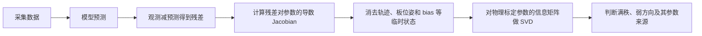

# 标定可观性入门：从单目、双目到 Camera–IMU

本文面向第一次接触“可观性”的读者。这里讨论的是**可观性（observability）**，不是
“客观性（objectivity）”。可观性回答的问题是：

> 仅根据这一次采集的数据，能不能把需要标定的参数与其他未知量稳定地区分开？

例如，求解器输出了一个 Camera–IMU 平移，并不等于数据真的把这个平移约束得很好。
如果平移改变 10 mm 后，运动轨迹和 IMU bias 稍作调整就能得到几乎相同的残差，那么这个
平移方向就是弱可观。优化器可以给出数字，但换一组噪声、初值或运动顺序，数字可能明显变化。

本文先建立直观认识，再说明本项目的数学推导和 `observability.yaml`，最后分别解释单目、
双目／多目、Camera–IMU、滚动快门相机和 RS Camera–IMU 任务。

## 1. 先用一个简单例子理解

假设单目相机看到一块标定板。图像里标定板的大小同时受两个量影响：

- 相机焦距；
- 标定板离相机的距离。

如果焦距变大，同时把标定板放远一点，预测图像可能几乎不变。只有一张正视图时，数据很难
区分“焦距更大”与“标定板更远”。这就是参数之间的补偿。

增加不同距离、不同倾角、不同图像位置的清晰图像后，同一组补偿无法同时解释所有图像，
焦距和每帧板位姿才会被分开。数据由此获得了更强的可观性。

可以把标定理解为寻找山谷最低点：

- 四周都很陡：参数变化会使残差明显增大，可观性强；
- 某个方向很平：参数沿这个方向移动很多，残差只变化一点，可观性弱；
- 某个方向完全平：无论怎样移动，数据都无法区分，严格不可观。



## 2. 可观性有什么作用

可观性主要有四个作用。

1. **发现参数虽然有输出值，却没有被数据稳定约束。**低 RMS 只能说明当前解能拟合当前
   数据，不能证明参数唯一。
2. **指导采集。**弱模态主要落在畸变时，应增加边缘覆盖和倾角；主要落在 Camera–IMU
   平移时，应增加多轴角速度、角加速度和线加速度变化。
3. **检查模型是否过于复杂。**数据可能足以估计 4 个内参，却不足以稳定区分多个高阶畸变
   系数或行时间。
4. **解释重复性。**多次标定 RMS 都很小但参数漂移，常见原因就是存在弱方向，不一定是
   硬件真的移动了。

可观性不是标定合格判定的全部。至少要同时检查：

| 维度 | 回答的问题 | 常用证据 |
|---|---|---|
| 拟合误差 | 当前模型能否解释当前标定集 | 每目 RMS、P95、Max、残差分布 |
| 可观性 | 当前数据能否稳定区分待标参数 | rank、奇异值、弱模态 |
| 独立准确度 | 参数能否解释没有参与求解的新数据 | 测试集 RMS、Alignment、三维误差 |
| 重复性 | 重复采集和求解能否得到一致参数 | 多次 K/D/R/t、时间偏移和行时间差值 |

以下几种情况都可能发生：

- RMS 小、可观性弱：当前数据能拟合，但某些参数组合不稳定；
- 可观性满秩、测试误差大：参数能被区分，但模型、角点或数据可能有系统偏差；
- 标定集和测试集误差都小、重复性差：可能存在弱方向，或不同数据的激励、温度、同步不同；
- 可观性强、重复性和独立测试都好：才是更完整的可信证据。

## 3. 从残差推导可观性

### 3.1 残差与 Jacobian

把需要交付的物理参数记作 $\boldsymbol\theta$。不同任务中的 $\boldsymbol\theta$ 不同，
可能包括 K、D、相机间外参、Camera–IMU 外参、时间偏移和行时间。

把求解时需要、但不作为本次可观性结论主体的临时未知量记作 $\mathbf p$，例如每帧标定板
位姿、连续轨迹控制点、速度、重力和 IMU bias。

观测与模型预测的差记作残差 $\mathbf r(\mathbf p,\boldsymbol\theta)$。在最终解附近施加小
变化，可用一阶展开近似：

$$
\mathbf r(\mathbf p+\delta\mathbf p,
          \boldsymbol\theta+\delta\boldsymbol\theta)
\approx
\mathbf r+
\mathbf J_p\delta\mathbf p+
\mathbf J_\theta\delta\boldsymbol\theta.
$$

$\mathbf J$ 就是 Jacobian。它的每一列表示“某个参数稍微变化时，所有残差怎样变化”。

- 某列几乎为零：观测对这个参数不敏感；
- 两列很相似：两个参数可能互相补偿；
- 某些列的线性组合接近零：存在弱参数组合。

程序使用经过观测噪声权重白化后的残差和 Jacobian。若最终问题使用 M-estimator，稳健权重
也会进入线性化；`uses_m_estimator` 记录是否实际存在这种权重。

#### 3.1.1 噪声白化是什么意思

像素、角速度和加速度的单位不同，测量精度也不同，不能把它们的原始数值直接平方后相加。
假设一项原始残差为 $\mathbf e$，测量噪声协方差为 $\boldsymbol\Sigma$。程序使用满足

$$
\mathbf L^\mathsf T\mathbf L=\boldsymbol\Sigma^{-1}
$$

的平方根信息矩阵 $\mathbf L$，构造白化后的残差和 Jacobian：

$$
\mathbf r_w=\mathbf L\mathbf e,
\qquad
\mathbf J_w=\mathbf L\mathbf J.
$$

若残差只有一个维度、标准差为 $\sigma$，它就是最容易理解的形式：

$$
r_w=\frac{e}{\sigma},
\qquad
J_w=\frac{J}{\sigma}.
$$

白化后的数值表示“误差相当于多少个标准差”。例如：

| 原始残差 | 预期标准差 | 白化残差 | 解释 |
|---:|---:|---:|---|
| 1 px | 0.5 px | 2 | 偏离 2 个标准差，权重较高 |
| 1 px | 2 px | 0.5 | 只偏离 0.5 个标准差，权重较低 |

两项原始误差都是 1 px，但第一项来自更可信的观测，所以对优化和可观性的信息贡献更大。
“白化”不是图像白平衡，也不是把残差均值减成零；它是按噪声协方差改变残差空间的尺度和
相关性。

最终的局部信息矩阵由白化 Jacobian 构成：

$$
\mathbf H=\mathbf J_w^\mathsf T\mathbf J_w.
$$

因此可观性不只由几何位置决定，也受噪声模型影响。把 `reprojection_sigma_px` 配得过小，等于
人为宣称角点非常精确，会放大图像约束；把 IMU 噪声配得过大，会降低 IMU 对外参、轨迹和
bias 的约束。数值上的“信息更强”只有在噪声模型可信时才有物理意义。

#### 3.1.2 M-estimator 又是什么

噪声白化对同一类正常观测使用事先给定的统计尺度。M-estimator 是第二层稳健处理：它根据
当前白化残差大小，降低异常观测对求解的影响。

普通最小二乘使用：

$$
s=\lVert\mathbf r_w\rVert^2.
$$

使用 M-estimator 后优化的是：

$$
\rho(s),
$$

其中 $\rho$ 可以是 Huber、Cauchy 或 Blake–Zisserman 等稳健代价。对小残差，$\rho(s)$ 通常
接近 $s$；对很大的残差，代价增长变慢。在线性化中可以直观地理解为：

$$
\mathbf r_{eff}\approx\sqrt{w(s)}\,\mathbf r_w,
\qquad
\mathbf J_{eff}\approx\sqrt{w(s)}\,\mathbf J_w,
$$

异常残差对应的 $w(s)$ 较小，所以它对参数更新和信息矩阵的影响下降。具体稳健化还取决于
求解器对 $\rho$ 的导数处理，上式用于理解权重作用。

两层权重的区别是：

| 机制 | 权重从哪里来 | 主要作用 |
|---|---|---|
| 噪声白化 | 配置的像素／IMU 协方差或标准差 | 让不同单位和精度的正常观测可比较 |
| M-estimator | 当前残差大小和稳健核 | 降低疑似离群观测的影响 |
| 硬异常点删除 | 过滤规则 | 把观测从最终问题中直接移除 |

`uses_m_estimator: true` 表示最终可观性分析遇到了至少一个带稳健核的误差项，SVD 反映的是
该误差项在最终残差处被稳健化后的局部信息。它不表示所有误差项都用了相同核，也不表示异常点
已被删除。

`uses_m_estimator: false` 表示最终分析问题没有 M-estimator，但仍然保留噪声协方差白化。
它也不能证明早期阶段没有做过角点过滤或硬异常点删除。以
`rs_camera_imu_normal_700107_1359` 为例，该字段为 false；图像残差仍按
`reprojection_sigma_px: 1.0` 加权，IMU 残差仍按 IMU 配置中的噪声模型加权。

### 3.2 为什么不能把轨迹或板位姿固定后直接分析

以单目标定为例。焦距变化后，每帧板位姿也可以变化。如果分析时把板位姿错误地固定，
就会高估焦距信息。正确的问题应允许所有临时状态作出最有利的补偿，然后观察相机参数还剩下
多少无法被补偿的信息。

完整 Jacobian 写成：

$$
\mathbf J=[\mathbf J_p\;\mathbf J_\theta].
$$

对应的 Gauss–Newton 信息矩阵为：

$$
\mathbf H=\mathbf J^\mathsf T\mathbf J=
\begin{bmatrix}
\mathbf H_{pp} & \mathbf H_{p\theta}\\
\mathbf H_{\theta p} & \mathbf H_{\theta\theta}
\end{bmatrix}.
$$

消去临时状态后，物理标定参数真正剩余的信息为：

$$
\boldsymbol\Omega=
\mathbf H_{\theta\theta}-
\mathbf H_{\theta p}\mathbf H_{pp}^{+}\mathbf H_{p\theta}.
$$

这个式子称为 Schur complement，$+$ 表示可处理秩亏的广义逆。当前实现使用稀疏 QR 和投影
完成等价计算，避免显式求逆。直观上，它在问：

> 当轨迹、板位姿和 bias 都允许重新调整后，物理标定参数的变化还会留下多少无法消除的残差？

`observability.yaml` 中的 `nuisance` 就是这些被先消去的临时状态。这里的 nuisance 意为
“本次分析不关心的未知量”，不是噪声，也不是无用参数。

### 3.3 单位归一化与 SVD

焦距使用 pixel，平移使用 m，旋转使用 rad，时间偏移使用 s。直接比较原始列的大小会被单位
影响。当前代码先对每个参数列做 L2 归一化，所以文件中记录：

```yaml
scaling: l2
```

随后对 reduced Fisher information $\boldsymbol\Omega$ 做 SVD：

$$
\boldsymbol\Omega=
\mathbf U\operatorname{diag}(\sigma_1,\ldots,\sigma_n)\mathbf V^\mathsf T,
\qquad \sigma_1\geq\cdots\geq\sigma_n\geq0.
$$

每个 $\mathbf V_i$ 都是多个参数共同变化的一个方向，$\sigma_i$ 表示这个方向的信息强度。
因此不能把第一个奇异值简单理解成 `fx`，也不能把最后一个奇异值简单理解成 `tz`。

- $\sigma_i$ 大：这一组合稍微变化，残差就明显增大；
- $\sigma_i$ 小：这一组合可以变化较多，残差仍变化很小；
- $\sigma_i$ 接近零：数据局部无法区分这一组合。

### 3.4 严格秩与工程秩

当前实现给出两套阈值。

严格数值阈值为：

$$
\text{tol}_{hard}=\sigma_{max}\,\epsilon_{machine}\,n.
$$

它用于判断真正的结构性或数值零方向，对应 `rank/deficiency` 和 `status`。

工程阈值为：

$$
\text{tol}_{operational}=\sigma_{max}\times10^{-6}\times n.
$$

它沿用增量相机求解器的 `epsSVD=1e-6`，用于标记理论非零、但不适合稳定更新的方向，
对应 `operational_rank/operational_deficiency` 和 `quality`。

所以以下结果并不矛盾：

```yaml
status: full_rank
quality: weakly_observable
```

它表示所有方向都有一点信息，但部分方向相对最强方向太弱，容易受像素噪声、运动变化、初值
和数据选择影响。

## 4. 可观性是局部的，也是数据相关的

本项目的诊断在最终解处重新线性化，因此它是**局部可观性**：只描述最终参数附近的小变化。
它不能保证不存在另一个相距很远、残差相近的非线性解。

可观性同时依赖：

- 本次采集的姿态、距离、运动速度和运动方向；
- 哪些图像、角点和 IMU 样本最终进入问题；
- 相机、畸变、快门和 IMU 模型；
- 哪些参数 active、哪些固定；
- 残差权重、噪声参数和稳健核；
- 最终线性化所在的解。

因此不能把一份数据的可观性结论永久复制到另一份数据，也不能只凭“帧数很多”判断可观性。
100 张几乎相同的正视图可能不如 20 张覆盖充分、角度互补的图像。

提供初值只帮助求解器找到某个解，并不会增加观测信息。冻结参数会减少待估自由度，使剩余问题
更容易求解，但这表示外部先验承担了约束，不能据此声称原始数据已经能观测被冻结的参数。

### 4.1 SLAM 和 VIO 也使用局部线性化吗

会。标定、Bundle Adjustment、因子图 SLAM 和 VIO 都是在求解非线性状态估计问题。主流的
Gauss–Newton、Levenberg–Marquardt、EKF 和滑动窗口后端都需要在某个状态附近计算 Jacobian。
因此由当前 Jacobian/Hessian 得到的秩、条件数和高斯协方差，本质上也是局部结果。

- GTSAM 的 `Marginals` 明确在用户给定的线性化点附近计算 Gaussian marginals；
- Ceres 的协方差使用最终点 $x^*$ 的 $J(x^*)^\mathsf TJ(x^*)$；
- ORB-SLAM 系列使用非线性 Bundle Adjustment，并固定部分 keyframe 来消除 gauge freedom；
- OpenVINS 分析线性化系统的可观矩阵，并使用 First-Estimate Jacobian 保持正确的不可观子空间。

参考：[GTSAM Marginals](https://borglab.github.io/gtsam/marginals/)、
[Ceres covariance](https://ceres-solver.readthedocs.io/latest/nnls_covariance.html)、
[ORB-SLAM3](https://arxiv.org/abs/2007.11898)和
[OpenVINS FEJ](https://docs.openvins.com/fej.html)。

SLAM 比离线标定多一个必须区分的问题：**gauge freedom**。它不是数据采得不好，而是世界坐标
原点和方向本来就是人为选择的。例如在没有绝对位置或方向传感器时：

| 系统 | 典型先天不可观自由度 |
|---|---|
| 纯单目 SLAM | 全局平移 3、全局旋转 3、全局尺度 1，共 7 DoF 的 Sim(3) gauge |
| 双目／RGB-D SLAM | 尺度由传感器提供，但全局平移和旋转仍可任意选择，共 6 DoF |
| 一般激励下的 VIO | 重力使 roll/pitch 和公制尺度可确定，通常仍剩全局平移 3 和绕重力 yaw 1，共 4 DoF |

实现中常固定第一帧或增加先验，使线性系统能够求解。这样做只是选择坐标基准，并不表示传感器
真的观测到了世界原点或绝对 yaw。回环能显著改善相对一致性和漂移，也不会自动提供绝对坐标
基准。

在线 SLAM/VIO 还有边缘化问题：旧状态被边缘化后，其先验通常保留在旧线性化点，而当前状态
继续变化。若处理不当，系统可能沿理论不可观方向获得“虚假信息”，表现为协方差过小、估计器
过度自信。OpenVINS 使用 FEJ，让相关 Jacobian 保持一致的首次线性化点，以维护 VIO 正确的
4 DoF 不可观子空间。FEJ 改善的是一致性，仍不能证明非线性目标只有一个全局解。

### 4.2 除最终点 SVD 外，还有哪些方法

没有一种方法能在通用的大规模非线性标定或 SLAM 中同时做到全局证明、计算便宜、适合在线、
还能直接反映真实噪声。不同方法回答不同问题，应组合使用。

还要避免混淆三个问题：结构性可观性研究“理想模型下哪些状态原则上能被测量区分”；局部
数值可观性研究“这份数据在当前解附近约束有多强”；全局最优性研究“优化器找到的是否是整个
非线性代价面的最低点”。解决其中一个，不会自动解决另外两个。

| 方法 | 比最终点 SVD 多回答什么 | 局限 |
|---|---|---|
| 解析／结构性可观性 | 从系统方程证明哪些 gauge 永远不可观，并推导哪些运动会退化 | 推导复杂；通常给出条件，不量化这次真实数据有多强 |
| FEJ／observability-constrained 更新 | 防止在线滤波或边缘化沿理论不可观方向制造虚假信息 | 保持一致性，不寻找远处的其他极小值 |
| 参数剖面（profile likelihood） | 把某参数或弱模态推离最终值，每次重优化其他状态，直接画真实非线性代价谷 | 每个扫描点都要重新求解；一次通常只检查少数方向 |
| 多初值／多起点求解 | 检查相距较远的初值是否落到不同、代价相近的解 | 找不到第二个解不等于证明它不存在 |
| bootstrap／删帧／分段重算 | 量化观测扰动和数据选择对参数的实际影响 | 依赖重采样设计，不能证明结构性唯一 |
| 重复采集 | 同时暴露检测噪声、运动变化、温度和硬件装配变化 | 无法单独区分每种误差来源 |
| 独立测试集／外部真值 | 检查参数对未参与拟合的数据是否真的有效 | 需要额外数据或测量设备 |
| 后验采样（MCMC 等） | 可能显示非高斯、偏斜和多峰后验 | 对高维轨迹、地图和 spline 问题通常非常昂贵 |
| 可认证全局优化 | 在满足特定模型和噪声条件时证明全局最优或给出界 | 适用模型有限，难直接覆盖完整 K/D/RS/IMU 联合问题 |

解析 VINS 自标定研究可以在模型层面证明：一般充分激励下仍有全局平移和 yaw 四个 gauge，
同时完整 6 轴激励可使许多传感器标定参数可观；单轴旋转、平面运动等会额外造成退化。它比
一份最终 Hessian 更能解释“为什么这种运动一定不够”，但仍需要数值诊断判断某次真实采集是
强还是勉强。参考
[VINS 全参数自标定与退化运动分析](https://arxiv.org/abs/2201.09170)。

### 4.3 本项目更可靠的组合方式

对本项目，当前 reduced Fisher information 和 SVD 应继续保留，它便宜、能直接定位最终实际
数据中的弱参数块。若要比现在更严谨，建议按以下层次增加证据：

1. **结构层：**为单目、双目、Camera–IMU 和 RS 任务列出理论 gauge 与已知退化运动，检查
   本次采集是否违反必要激励条件。
2. **局部层：**保留最终解的 reduced Hessian、严格秩、工程秩和弱模态。这一层回答“当前
   解附近哪里平”。
3. **非线性层：**沿最弱奇异向量做参数剖面。把参数从最终值逐步推向正负方向，每一点都重新
   优化轨迹、bias 和其他自由参数，再画 $\Delta J$。若很宽范围内代价几乎不变，就直接显示
   一条真实的非线性平谷；若出现另一低谷，就发现局部 SVD 无法看到的候选解。
4. **稳定性层：**使用相距足够远的物理初值、多段 bootstrap、删帧和重复采集，比较参数与
   代价，不只比较是否“求解成功”。
5. **外部验证层：**固定最终参数，在完全独立的数据上计算重投影、Alignment、时间补偿和
   三维几何误差；需要绝对结论时引入外部定位或已知尺寸真值。

对 `normal_700107_1359`，最有针对性的下一步不是单纯再算一次协方差，而是保存两个平移弱模态
的完整向量，并沿其做 profile likelihood；同时对不同运动片段做 bootstrap，并用另一组动态
数据固定外参验证。这样能判断当前两个局部弱平移方向是否形成很宽的非线性代价谷。即便这些
实验都通过，也应表述为“在给定范围、初值和测试数据内没有发现竞争解”，而不是全局唯一证明。

## 5. 单目标定怎样理解可观性

普通单目任务主要估计：

```text
K：fx、fy、cx、cy，以及模型可能包含的其他投影参数
D：畸变参数
```

每张图像的标定板位姿是 nuisance，通常包含 3 个旋转和 3 个平移自由度。已知标定板格点的
实际尺寸提供公制尺度。

| 数据特点 | 容易变弱的参数或组合 | 原因 |
|---|---|---|
| 全是正视、距离接近 | 焦距与板深度 | 两者可以共同缩放图像 |
| 标定板总在图像中央 | 主点和畸变 | 缺少边缘成像半径 |
| 角点很少到达四角 | 高阶畸变 | 高阶项主要在大半径处显现 |
| 没有绕水平轴、垂直轴的倾斜 | `fx/fy`、主点与位姿组合 | 透视关系单一 |
| 图像模糊或角点集中 | 多个内参方向 | 有效信息少且噪声大 |
| 大量相邻重复帧 | 通常不会增加新方向 | 重复测量只增加相似约束 |

改善方法是让清晰角点覆盖中心、边缘和四角，包含近、中、远距离，并让标定板绕水平轴、
垂直轴和光轴产生互补倾角。不要为了追求数量保留大量几乎相同的位姿。

单目 RMS 小而某些畸变参数弱，意味着这些系数组合可以互相补偿。当前图像可能校正得不错，
但换分辨率、温度或边缘测试图时，误差和参数重复性可能变差。

## 6. 双目／多目标定怎样理解可观性

双目普通联合标定通常估计：

```text
cam0 K/D
cam1 K/D
T_cam1_cam0 的 3 维旋转和 3 维平移
```

多目系统继续增加相邻 `T_cn_cnm1`。同一时刻的共同角点把不同相机连接到一个相机图中。
同步时间接近但没有共同全局角点 ID，不能提供有效的双目共视约束。

双目中除了单目弱方向，还会出现：

| 数据特点 | 可能影响 |
|---|---|
| 左右目共同角点少 | baseline 旋转和平移约束减弱 |
| 共同角点只在很窄的深度范围 | 某些平移与板位姿容易补偿 |
| 标定板姿态变化少 | baseline 旋转与每帧板姿态耦合 |
| 左右时间戳错配、运动中不同步 | 外参被迫吸收时间误差，可能低重复或有偏 |
| 单目边缘覆盖不足 | K/D 弱，并可进一步影响外参 |

已知 AprilGrid 或棋盘格尺寸提供绝对尺度，因此双目基线长度不是天然无尺度。但“有尺度”不等于
“约束强”：如果距离和姿态变化不足，某些 baseline 分量仍可能弱。

使用可靠 K/D seed 并设置 `freeze_intrinsics: true` 时，分析问题主要剩下相机间外参。此时
外参可能更稳定，是因为内参由外部结果固定，不代表这组双目数据也能重新识别内参。

`incremental`、`full_batch` 或 shuffle 会改变优化路径、数据选择和最终线性化点，但不会凭空
创造信息。若两种模式最终使用完全相同的角点、达到同一个解，其局部可观性原则上应接近；
增量选择若剔除了重复或有害观测，则可能改变最终信息结构。

## 7. 普通 Camera–IMU 标定怎样理解可观性

本项目的 Camera–IMU 任务读取上一阶段相机结果。K/D 通常固定；双目／多目相机链是否在联合
阶段更新由 `recompute_camera_chain_extrinsics` 控制。常见待估物理参数包括：

- `T_cam0_imu` 的旋转和平移；
- 每台相机的 Camera–IMU 时间偏移；
- 配置允许时的相机链外参；
- 多 IMU 相对外参、时间偏移或已启用的 IMU 内参。

连续位姿轨迹、速度、重力和随时间变化的陀螺仪／加速度计 bias 等作为 nuisance 消去。

### 7.1 为什么旋转运动约束外参旋转

相机从图像估计设备朝向变化，陀螺仪测量角速度。设备绕多个轴做变化丰富的旋转后，只有正确
的 Camera–IMU 旋转才能使两者在完整序列上对应。

若设备几乎不旋转，或一直只绕同一轴匀速旋转，某些旋转方向和时间偏移就可能互相补偿。

### 7.2 为什么 Camera–IMU 平移通常更难

Camera–IMU 平移也叫 lever arm。刚体旋转时，离旋转中心不同位置的传感器会产生不同线加速度。
其主要关系包含：

$$
\mathbf a_{lever}=
\boldsymbol\alpha\times\mathbf r+
\boldsymbol\omega\times(\boldsymbol\omega\times\mathbf r),
$$

其中 $\mathbf r$ 是 Camera–IMU 平移，$\boldsymbol\omega$ 是角速度，
$\boldsymbol\alpha$ 是角加速度。

如果角速度和角加速度都小，$\mathbf r$ 改变几毫米造成的加速度差可能小于 bias、振动和噪声，
轨迹与 bias 便能吸收这种变化。此时旋转外参可能稳定，而平移仍弱。

改善 Camera–IMU 平移可观性时，应在标定板持续清晰可见的前提下：

- 绕至少两个、最好三个轴进行正反方向旋转；
- 让角速度有明显变化，而不是长时间匀速；
- 增加角加速和角减速；
- 加入不同方向的平移加减速；
- 避免所有线加速度都与重力近似共线；
- 保证图像和 IMU 使用同一可靠时钟，时间戳语义正确。

### 7.3 时间偏移怎样变得可观

时间偏移满足：

$$
t_{imu}=t_{cam}+\Delta t.
$$

若运动几乎静止或长期匀速，时间平移前后的轨迹很相似，$\Delta t$ 很难确定。角速度和加速度
随时间出现清晰变化时，把相机轨迹向前或向后平移会产生明显不一致，时间偏移才容易被识别。

高采样率本身不能替代运动变化；精确时间戳比“名义频率完全固定”更重要。频率波动但时间戳
准确时，轨迹仍可按真实时刻计算，不过 IMU 噪声密度、更新率和丢样仍需正确建模。

## 8. Rolling Shutter 任务怎样理解可观性

滚动快门第 $y$ 行角点的时刻为：

$$
t_{row}=t_{frame}+\Delta t+(y-y_{ref})\tau,
$$

其中 $\tau$ 是每行时间。要估计 $\tau$，至少需要：

- 角点覆盖多个图像行；
- 曝光期间存在足够运动；
- 不同行角点所看到的运动差能超过检测噪声；
- 连续轨迹的带宽和运动先验不会任意吸收同一变化。

静态图像即使非常清晰，也几乎不能提供行时间信息。只在图像中央一小段行范围检测到角点，
首末行时间差也太小。单一、平滑、低变化的运动还可能使行时间与轨迹形状互相补偿。

纯视觉 `cameras-rs` 的物理参数包括 K/D、相邻相机外参和每目行时间；连续目标轨迹是
nuisance。RS Camera–IMU 还加入 `T_cam0_imu` 和每目时间偏移，并由 IMU 约束连续轨迹。

行时间采用有界 latent 参数：

$$
\tau=\tau_{max}\tanh(q).
$$

因此 `observability.yaml` 中的 `line_delay_latent` 是无量纲 $q$，不是 µs/行。接近边界时
$d\tau/dq$ 会变小，不能只凭 latent 奇异值直接计算物理行时间不确定度。

RS Camera–IMU 中还要区分：

- `time_offset`：整幅图像参考时刻与 IMU 时钟的公共偏移；
- `line_delay`：相邻图像行之间的时间差；
- 连续轨迹：设备在时间上的实际位姿变化。

只有数据包含足够的时间和行方向激励，三者才不容易互相补偿。正式结论还应通过固定零行时间、
反方向行时间、多初值、轨迹带宽敏感性和独立测试集验证。

## 9. 怎样读 `observability.yaml`

| 字段 | 含义 |
|---|---|
| `status` | 严格机器精度阈值下的状态 |
| `quality` | 工程阈值下是否存在弱方向 |
| `state: final_relinearized` | 在最终解重新计算导数，只读分析 |
| `uses_m_estimator` | 本次分析误差项是否含稳健核权重 |
| `damping_applied` | 是否把优化阻尼加入信息矩阵；当前为 false |
| `scaling: l2` | 参数列按 L2 归一化 |
| `linearization` | 原始误差项和等价展开后的误差项数量 |
| `parameter_blocks` | 被选择分析的物理参数、自由度、单位、活动状态和 offset |
| `nuisance` | 被先消去的临时状态列数及 QR 秩 |
| `calibration.columns` | active 物理标定自由度总数 |
| `rank/deficiency` | 严格秩和严格缺失方向数 |
| `operational_rank/deficiency` | 工程秩和工程弱方向数 |
| `singular_values` | 从强到弱的信息谱 |
| `condition_information_observable` | 最大与严格最小可观信息值之比 |
| `condition_jacobian_equivalent` | 上述条件数的平方根 |
| `nullspace_modes` | 严格不可观方向的参数块贡献 |
| `operationally_truncated_modes` | 工程弱方向的参数块贡献 |

`parameter_blocks[].offset` 是参数块在分析向量中的起始列，不是图像偏移或时间偏移。

弱模态中的 `contribution` 是归一化奇异向量在各参数块上的平方占比。例如：

```yaml
- block: camera_imu.T_cam0_imu.translation
  contribution: 0.99936
```

表示该弱方向约 99.936% 落在 Camera–IMU 平移参数块。它不是误差百分比、概率、毫米变化量或
置信度。当前文件按参数块汇总，没有保存弱向量中 `tx/ty/tz` 的正负与占比时，就不能判断
具体哪个物理轴最弱。

固定参数会显示 `active: false`、`active_dimension: 0` 和 `offset: null`。这只说明本次没有
重新估计该参数，不能用来证明它可观。

## 10. `normal_700107_1359` 实例

文件位于：

```text
Q:\File\machine_data\kalibr_no_ros\mechine-3008-imu\result\
rs_camera_imu_normal_700107_1359\rs_camera_imu_normal_700107_1359\observability.yaml
```

本次任务固定静态双目的 K/D/T，配置为：

```yaml
recompute_camera_chain_extrinsics: false
recover_covariance: false
calibrate_time_offset: true
```

所以 active 的 10 个自由度是：

| 参数 | 自由度 |
|---|---:|
| `T_cam0_imu.rotation` | 3 |
| `T_cam0_imu.translation` | 3 |
| cam0 时间偏移 | 1 |
| cam0 行时间 latent | 1 |
| cam1 时间偏移 | 1 |
| cam1 行时间 latent | 1 |

`T_cam1_cam0` 的旋转和平移显示为 inactive，因为本次任务使用静态双目标定结果并固定相机链。

结果为：

```text
严格秩：10/10
工程秩：8/10
工程弱方向：2 个
```

两个工程弱方向中，`T_cam0_imu.translation` 的贡献分别为约 99.936% 和 99.964%。旋转只占
约 0.064% 和 0.036%，两目的时间偏移与行时间贡献接近零。

正确结论是：

> 当前数据没有严格不可解方向，但 Camera–IMU 平移有两个组合方向明显偏弱。弱可观性的主因
> 不是固定的双目外参，也不是两个行时间或时间偏移。多次标定中出现毫米级 Camera–IMU 平移
> 差异时，应优先检查运动激励以及平移与轨迹、bias、重力之间的补偿。

不能从这份文件直接得出：

- 是 `tx`、`ty` 还是 `tz` 最弱；
- 平移标准差是多少毫米；
- 真实硬件发生了多少位移；
- 行时间已经通过独立测试验证。

因为本次 `recover_covariance: false`，文件没有参数协方差；即使有局部协方差，也仍需检查
噪声模型、线性化近似和独立测试。

## 11. 按任务改进采集的速查表

| 任务 | 首要覆盖 | 首要运动／姿态 | 常见弱项 |
|---|---|---|---|
| 单目 | 中心、边缘、四角，近中远 | 三轴倾角，避免重复正视 | 焦距／深度、主点、高阶畸变 |
| 双目／多目 | 各目共同角点和共同视场 | 多距离、多倾角、可靠同步 | baseline 某些分量、K/D 与外参耦合 |
| Camera–IMU | 图像持续清晰、IMU 不饱和 | 多轴变速旋转、角加减速、不同方向平移加减速 | lever arm 平移、时间偏移、bias 耦合 |
| 纯视觉 RS | 角点跨越大量图像行 | 曝光期间有丰富且连续的运动 | 行时间与轨迹/K/D 耦合 |
| RS Camera–IMU | 同时满足视觉、行覆盖和 IMU 条件 | 多轴角速度/角加速度变化并保持可靠同步 | 平移、时间偏移、行时间与轨迹耦合 |

发现弱模态后，应根据 `dominant_blocks` 定向补数据，而不是只增加相似帧：

- `intrinsics/distortion` 主导：增加边缘、四角、距离和倾角覆盖；
- `camera_chain.rotation/translation` 主导：增加共同角点、深度和板姿态变化，检查同步；
- `T_cam0_imu.rotation` 主导：增加多轴旋转；
- `T_cam0_imu.translation` 主导：增加角速度、角加速度和多方向线加速度变化；
- `time_offset` 主导：增加速度随时间明显变化的运动并核对时间戳语义；
- `line_delay_latent` 主导：增加跨行角点和曝光期间运动，并做轨迹带宽与正反值对照。

## 12. 使用时的最终检查顺序

1. 确认任务成功收敛，输入、模型、时间戳和坐标方向正确。
2. 查看最终实际使用的帧、共同角点和 IMU 区间，而不是只看输入数量。
3. 检查标定集 RMS、P95、Max 和残差随图像位置、时间的结构。
4. 查看 `status`；严格秩亏时不能把结果当成完整可解。
5. 查看 `quality`、工程秩和弱模态的 `dominant_blocks`。
6. 使用独立测试集检查每目 RMS、Alignment 和需要的三维指标。
7. 使用重复采集检查 K/D/R/t、时间偏移和行时间的重复性。
8. 若弱项与独立误差或重复性对应，按弱参数块补充有针对性的采集激励。

可观性诊断的源码入口是
[`observability.py`](../src/python/kalibr_no_ros/observability.py)，原生只读线性化、消元、缩放和
SVD 位于
[`LinearSolver.cpp`](../src/kalibr/calibration/incremental_calibration_python/src/LinearSolver.cpp)。
任务何时要求并挂接该文件见 [`task.py`](../src/python/kalibr_no_ros/task.py)。配置字段和正式输出
契约分别见[任务参数](TASK_PARAMETERS_ZH.md)与[输入和输出说明](DATASET_WORKFLOW_ZH.md)。
