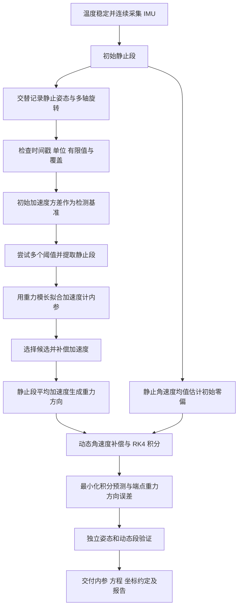

# imu_tk 标定流程与自研 IMU 内参方案

`imu_tk` 的核心是先用多个静止姿态的重力模长标定加速度计，再用相邻姿态之间的
角速度积分标定陀螺仪。它适合参考实现独立 IMU 内参标定；静止姿态和姿态之间的
动态记录必须一起保留。

后续自研应先明确输入单位、补偿方程和输出坐标系，再实现分段、求解与验证。
完整内参结果应与 Allan 噪声参数分开交付，与 Camera–IMU 的对接也需要单独转换。

## 参考版本与适用范围

源码核对版本为 [Kyle-ak/imu_tk](https://github.com/Kyle-ak/imu_tk)，固定提交
[`7780270fb9a227c79323199303f23989e689a89d`](https://github.com/Kyle-ak/imu_tk/tree/7780270fb9a227c79323199303f23989e689a89d)。
作者项目入口为 [Alberto Pretto 的 Bitbucket 仓库](https://bitbucket.org/alberto_pretto/imu_tk)。
以下涉及实现细节的结论以该 GitHub 提交为准。

理论来源是 Tedaldi、Pretto、Menegatti 的 ICRA 2014 论文
[A Robust and Easy to Implement Method for IMU Calibration without External Equipments](https://doi.org/10.1109/ICRA.2014.6907297)，
可结合[作者上传的全文](https://www.researchgate.net/publication/273383944_A_robust_and_easy_to_implement_method_for_IMU_calibration_without_external_equipments)
中的 III、IV 节和公式核对。下文分别标明论文描述、源码行为与自研建议。

| 工作流 | 主要输入 | 主要估计量 |
|---|---|---|
| Allan 分析 | 长时间静止记录 | 白噪声密度和随机游走等随机误差参数 |
| 六面或十二面静态标定 | 多方向静止记录，可能带夹具方向约束 | 加速度计偏置、尺度；是否能估完整非正交项取决于约束和方向覆盖 |
| imu_tk 多姿态标定 | 初始静止、多姿态静止及其间连续旋转记录 | 加速度计和陀螺仪的偏置、尺度、轴不对准参数 |
| Camera–IMU 标定 | 相机、IMU 与标定板运动记录 | 相机与 IMU 的空间、时间关系，以及所选 IMU 模型的活动参数 |

原方法假设采集期间局部重力模长和温度稳定、短时偏置可用简单模型描述。
它没有独立估计温度补偿、陀螺加速度敏感项、传感器测点杆臂、加速度计与陀螺仪的
时间偏移，或 IMU 到外壳、机器人、相机的外参。这些量不能从未包含它们的模型中交付为
“已标定”。

## 完整流程



严格输入检查、独立验证和正式报告是自研工作流应补充的环节，原版示例主要输出两份
`.calib` 文本。原版求解调用链见
[calibrateAcc 与 calibrateAccGyro](https://github.com/Kyle-ak/imu_tk/blob/7780270fb9a227c79323199303f23989e689a89d/src/calibration.cpp#L152)。

## 采集与输入

### 数据采集

先让设备达到适合标定的稳定温度，再完整录下以下过程：

1. 开始时保持 IMU 静止，建立静止噪声基准并估计陀螺仪均值偏置。
2. 手动转动 IMU 到一个新姿态，放稳后保持静止。
3. 重复不同方向的倾斜和旋转，覆盖三维空间，保留每次转动的完整记录。
4. 另外采集一组姿态与旋转作为验证数据，避免只报告拟合数据上的误差。

论文 IV-D 给出的姿态数下限为 9，经验范围为 36–50 个不同姿态，每次静止 1–4 s。
论文 IV-A 的静止检测窗为 2 s；IV-C 使用的 50 s 初始化段是 Xsens 的示例设置，
并通过 Allan 分析选择，不是所有 IMU 的固定要求。

源码默认检测窗为 101 个样本，有效静止段的长度门槛为至少 100 个样本。在约 100 Hz
的输入上，动作边界会进一步缩短被识别为静止的区域，因此不能只按“静止 1 s”安排
采集。自研首轮试验可先使用 50 s 初始静止、约 40 个姿态、每姿态静止 3–5 s，
再根据实际有效段长度和方向覆盖调整；这些是建议试验值，尚不是本工程的运行默认值。

不要只绕竖直轴转动，也不要反复使用几个几乎相同的姿态。单个重力方向不能提供
完整三自由度的相对姿态；绕重力方向的纯转动尤其缺少方向变化证据。多轴旋转、不同
倾角和足够的重力方向变化共同决定陀螺仪参数是否可观。

### 输入适配

本工程现有 CSV 列序为：

```text
timestamp_ns,wx,wy,wz,ax,ay,az[,temperature 或 temperature_c]
```

角速度为 `rad/s`，加速度为 `m/s²`，时间戳为整数纳秒。后续适配应保留原始 CSV，
先用整数计算 `timestamp_ns - first_timestamp_ns`，再乘 `1e-9` 得到相对秒数，避免
先把很大的绝对纳秒时间戳转成浮点数而丢失精度。

原版输入有以下差别，见
[io_utils.cpp](https://github.com/Kyle-ak/imu_tk/blob/7780270fb9a227c79323199303f23989e689a89d/src/io_utils.cpp#L40)
和 [test_phone_calib.cpp](https://github.com/Kyle-ak/imu_tk/blob/7780270fb9a227c79323199303f23989e689a89d/apps/test_phone_calib.cpp#L21)：

| 原版入口 | 实际格式 | 适配要求 |
|---|---|---|
| 两个独立文件 | 每文件 `t,x,y,z` 四列 ASCII；`xsens_*.mat` 也是文本 | 分别读取 acc 和 gyro，核对时间单位 |
| phone 合并文件 | `t,ax,ay,az,wx,wy,wz` | 与本工程六轴字段顺序不同，不能直接传入 |
| 默认时间单位 | 读取函数默认微秒，示例显式指定秒 | 必须显式声明，不能依赖默认值 |
| 轴数值 | 不自动转换物理单位 | 原始计数与 SI 输入需采用不同的尺度初值和单位声明 |

自研输入检查应拒绝非有限值、非递增时间戳、单位或列序不明的数据；对长间隙、饱和、
缺少动态段或 acc/gyro 时间覆盖不足给出明确失败原因。温度用于记录工况，不能仅因
CSV 中存在温度列就宣称已经实现温度补偿。

## 加速度计标定

### 补偿模型与参数

统一使用源码的减偏置约定：

$$
\boldsymbol a_c=\boldsymbol C_a(\boldsymbol a_r-\boldsymbol b_a),
\qquad \boldsymbol C_a=\boldsymbol T_a\boldsymbol K_a.
$$

其中 `r` 为输入域，`c` 为补偿后的正交参考系。尺度矩阵是
`K_a = diag(s_x,s_y,s_z)`，而加速度计的轴不对准矩阵限定为：

$$
\boldsymbol T_a=
\begin{bmatrix}
1&-m_{yz}&m_{zy}\\
0&1&-m_{zx}\\
0&0&1
\end{bmatrix}.
$$

共优化 9 个参数：3 个轴不对准参数、3 个尺度和 3 个输入域偏置。执行顺序是先减
`b_a`，再乘 `K_a`，最后乘 `T_a`；不能交换矩阵顺序，也不能把 `b_a` 当成已经补偿后的
偏置。若写成 `C_a*a_r - b'_a`，则必须使用 `b'_a=C_a*b_a`。
定义见 [CalibratedTriad](https://github.com/Kyle-ak/imu_tk/blob/7780270fb9a227c79323199303f23989e689a89d/include/imu_tk/calibration.h#L35)。

SI 输入时，加速度偏置单位为 `m/s²`、角速度偏置单位为 `rad/s`，尺度为无量纲修正；
计数输入的偏置则在计数域，尺度需承担物理单位转换。`T_a/T_g` 是非正交修正矩阵，
不是 SO(3) 旋转；轴不对准参数的小角解释不能直接当作精确 Euler 角或外参旋转。

上三角约束固定了一个坐标选择。根据重力模长模型，对任意正交矩阵 `Q`，
`||Q*C_a*(a_r-b_a)||` 都不变，因此静态模长只能辨认 `C_aᵀ*C_a`，不能同时决定一个
任意的三维公共旋转。这是模型的可观性推论；选定上三角参考系并不意味着得到了
IMU 到外壳或机器人坐标系的安装旋转。

### 静止段检测

源码用每轴样本方差组成向量，再取欧氏范数作为检测量：

$$
v=\sqrt{\operatorname{var}(a_x)^2+
         \operatorname{var}(a_y)^2+
         \operatorname{var}(a_z)^2}.
$$

初始静止段的同一统计量作为基准 `v_init`，依次尝试阈值 `k*v_init`，
其中 `k=2,3,...,10`。窗口统计量小于阈值时判为静止。它不是加速度模长的方差，
也不是对三个标准差直接求和。

每个候选阈值都会重新提取静止段并从相同参数初值求解。源码丢弃短于 100 个样本的段，
有效段少于 12 个则跳过该候选。`acc_use_means=false` 时每段取前 100 条样本；
设为 `true` 时对整个有效段取均值，而非仅对前 100 条取均值。
见 [staticIntervalsDetector](https://github.com/Kyle-ak/imu_tk/blob/7780270fb9a227c79323199303f23989e689a89d/src/filters.cpp#L33)
及 [extractIntervalsSamples](https://github.com/Kyle-ak/imu_tk/blob/7780270fb9a227c79323199303f23989e689a89d/include/imu_tk/base.h#L384)。

### 重力残差与候选选择

对每个被选中的静止样本或均值，C++ 实现使用一个标量残差：

$$
r_{a,i}=g-\left\|\boldsymbol C_a(\boldsymbol a_{r,i}-\boldsymbol b_a)\right\|.
$$

随后最小化平方残差和。`g` 是已知的局部重力模长；若同时任意估计 `g` 和加速度计
的公共尺度，会产生尺度歧义。自研时应明确其来源和单位，避免把一个地点的示例数值
当成所有设备的标定真值。

原版使用 Ceres 自动微分、平方损失和 `DENSE_QR`，其他求解器设置沿用依赖默认值；
没有显式 robust loss。最终按各候选的 `summary.final_cost` 原始总成本选最小者，
没有按残差数量归一化。不同阈值可能产生不同数量的样本，因此后续若改成均方误差或
独立验证集评分，应作为自研算法选择记录，不能称为逐项复刻原版。

得到选中参数后，对全部加速度数据进行补偿，供后续陀螺仪阶段使用。残差和候选循环见
[calibration.cpp](https://github.com/Kyle-ak/imu_tk/blob/7780270fb9a227c79323199303f23989e689a89d/src/calibration.cpp#L42)。

## 陀螺仪标定

### 初始偏置与重力方向

先对初始静止角速度求均值 `b_g0`，并从全部陀螺仪样本扣除。再对选中静止段的已补偿
加速度求全段均值并单位化，得到每个姿态的单位重力方向 `u_i`。
这里以静止加速度的实测比力方向定义 `u_i`，应与导航公式中重力向量的正负方向区分，
并在两个端点保持一致。

陀螺仪使用同样的补偿方程：

$$
\boldsymbol\omega_c=\boldsymbol C_g(\boldsymbol\omega_r-\boldsymbol b_g),
\qquad \boldsymbol C_g=\boldsymbol T_g\boldsymbol K_g,
$$

但 `T_g` 有 6 个非对角自由参数，不再限定为上三角：

$$
\boldsymbol T_g=
\begin{bmatrix}
1&-m_{yz}&m_{zy}\\
m_{xz}&1&-m_{zx}\\
-m_{xy}&m_{yx}&1
\end{bmatrix}.
$$

默认只在动态阶段优化 6 个轴不对准参数和 3 个尺度，初始均值偏置保持固定。
显式开启 `enableGyroBiasOptimization(true)` 后，增加 3 个偏置增量，最终输出
`b_g=b_g0+delta_b_g`。所以“原版估计 gyro bias”不等于“默认联合优化 gyro bias”。

### 动态积分与残差

每一对相邻静止姿态贡献一段动态约束。源码从前一有效静止段结束时间开始，到后一
静止段开始时间之前取陀螺样本；不会对积分边界插值，也不会估计 acc–gyro 时间偏移。

对候选内参补偿角速度后，从单位四元数 `[w,x,y,z]=[1,0,0,0]` 开始进行 RK4 积分。
每步使用相邻角速度 `omega0`、`omega1`，中间两级使用二者的平均，并在每步归一化四元数。
默认 `gyro_dt=-1`，实际使用相邻时间戳差；只有显式设置正 `dt` 时才固定步长。
见 [integration.h](https://github.com/Kyle-ak/imu_tk/blob/7780270fb9a227c79323199303f23989e689a89d/include/imu_tk/integration.h#L124)。

源码的三维残差为：

$$
\boldsymbol r_{g,i}
=\boldsymbol R_{\Delta,i}^{\mathsf T}\boldsymbol u_i-\boldsymbol u_{i+1}.
$$

按照该式定义，`R_delta` 把末端坐标的向量转到初始坐标，因而使用转置预测末端的重力
方向。自研统一采用项目约定 `${}^{A}_{B}\mathbf R` 时，可定义
`${}^{i+1}_{i}\mathbf R=R_deltaᵀ`；不能只根据变量名删掉转置。

两个单位方向的局部差异仅提供两个独立方向约束，虽然代码写出三个残差分量。
需要多个不同倾角和转轴的动态连接，才能支持完整陀螺矩阵。时间尺度误差也会与
陀螺公共尺度混淆，因此必须先保证时间单位和采样间隔正确。
完整阶段见 [MultiPosGyroResidual 与 calibrateAccGyro](https://github.com/Kyle-ak/imu_tk/blob/7780270fb9a227c79323199303f23989e689a89d/src/calibration.cpp#L74)。

## 论文与代码的差异

| 项目 | 论文描述 | 固定提交的 C++ 行为 |
|---|---|---|
| 偏置符号 | 式 6、9 使用 `raw+b` | 使用 `raw-bias`，参数符号不可直接互抄 |
| 加速度代价 | 式 10 使用 `g²-||h(a)||²` 的平方和 | 使用 `g-||h(a)||` 的平方和 |
| 姿态数 | 至少 9，经验 36–50 | 至少 12 个有效静止段 |
| 静止检测窗 | 2 s | 默认 101 个样本，与采样率相关 |
| 初始静止时长 | 按 Allan 特性选取，实验示例 50 s | 构造默认 30 s，示例改为 50 s |
| 加速度静止段使用 | 以静止均值描述约束 | 默认每段前 100 条，可切换全段均值 |

两种加速度残差的零点相同，但带噪时权重不同，不能仅凭理想数据解相同就认定为
同一个数值问题。后续应明确以论文公式、固定源码，还是自研改进为实现基准。

## 六面法与十二面法如何安排

“六面”和“十二面”首先描述采集姿态安排，不应直接决定可估计参数数量。

| 输入约束 | 能提供的证据 | 适用模型 |
|---|---|---|
| 六个未知方向的静止均值，只知模长 | 六个标量重力模长约束 | 不能据此辨认完整 9 参数加速度模型 |
| 精确六面夹具，已知每个姿态的完整重力向量 | 带方向的向量约束 | 可按夹具精度建立偏置与尺度或更完整模型，属于额外参考约束 |
| 十二个或更多不同未知方向，只知模长 | 更多模长约束 | 可尝试 9 参数模型，仍需检查方向覆盖和秩 |
| 上述静止段加连续多轴旋转 | 端点重力与角速度积分的一致性 | 支持 imu_tk 型 gyro 尺度和轴不对准拟合 |

这些结论来自模型的约束数量和坐标自由度。重复摆放、共面姿态或几乎单轴的运动都可能
使数据退化；达到 12 个段并不自动通过可观性检查。只保存十二面的静止均值，也不能
得到原方法所需的完整陀螺动态内参。

## 原版默认值与迁移注意点

默认值见 [MultiPosCalibration 构造函数](https://github.com/Kyle-ak/imu_tk/blob/7780270fb9a227c79323199303f23989e689a89d/src/calibration.cpp#L140)。

| 参数 | 原版默认值 | 作用与限制 |
|---|---|---|
| `g_mag` | `9.81`，SI 输入时单位 `m/s²` | 已知重力模长 |
| `init_interval_duration` | `30 s` | 开头静止基准，源码不自动证明这段真的静止 |
| `min_num_intervals` | `12` | 有效静止段数量下限，原版为常量成员 |
| `interval_n_samples` | `100` | 段长度门槛；非均值路径每段抽取前 100 条 |
| `acc_use_means` | `false` | 切换加速度计段均值路径 |
| 检测窗口 | `101` 个样本 | 自动调整为奇数且至少 11 个样本 |
| 阈值倍数 | `2..10` | 九个候选，比较原始总成本 |
| `gyro_dt` | `-1` | 使用时间戳差；正值才代表固定秒步长 |
| `optimize_gyro_bias` | `false` | 默认不联合优化初始均值后的剩余偏置 |

[Xsens 示例](https://github.com/Kyle-ak/imu_tk/blob/7780270fb9a227c79323199303f23989e689a89d/apps/test_imu_calib.cpp#L26)
另设 acc bias 初值 `[32768,32768,32768]`、gyro scale 初值 `[1/6258]*3`、`g=9.81744`。
这是该原始计数数据的设置，不能带进本工程的 SI CSV。SI 输入应从与设备输出契约一致的
偏置和近单位尺度开始。

原版 `.calib` 输出依次是 3×3 `T`、3×3 `K`、3×1 输入域 bias，属于文本而非 YAML，
不含本工程的版本、单位、坐标定义或报告；写出也未设置 17 位有效数字。
见 [CalibratedTriad::save](https://github.com/Kyle-ak/imu_tk/blob/7780270fb9a227c79323199303f23989e689a89d/include/imu_tk/calibration.h#L420)。

自研时应明确修正以下工程问题：

- 输入解析不能沿用“坏行跳过、文件打不开留下空数据”的行为。
- 求解成功需检查终止状态、有限值、尺度正值、矩阵可逆性、方向覆盖和秩；源码存在
  质量检查 TODO，示例还忽略 `calibrateAccGyro` 与 `save` 返回值，退出码 0 不足以验收。
- gyro 积分边界必须有有效索引、至少两个样本和足够覆盖；原版找不到边界时可能保留
  `-1` 索引，不能直接照搬。
- 原版先向 `calib_gyro_samples_` 放入 N 条去偏置数据，最终又追加 N 条完整补偿数据，
  没有清空；迁移不能把这个 2N 容器错误当成输出契约。
- 源码依赖 Ceres、Qt4、OpenGL 等；本工程明确不引入 Ceres，应参考模型和流程自行
  实现求解与报告，不直接接入整个旧工程构建链。源码版权头规定的保留要求也应随移植保留。

## 与当前 Kalibr 工程的关系

### 噪声与内参分开

`imu_allan` 交付的 `imu_noise.yaml` 是 `kind: imu_configuration`，只包含四项噪声、
采样率及可选话题等输入字段。当前
[load_imu](../src/python/kalibr_no_ros/task/validation.py) 会拒绝额外内参字段。
后续内参应独立交付，例如 `imu_intrinsics.yaml`，并附 HTML/PDF 报告；该文件名在这里
属于后续接口建议，尚不是当前已实现的输入契约。

### 补偿矩阵不等于当前的正向测量矩阵

`imu_tk` 输出 `corrected=C*(raw-b)`。本工程当前 `scale-misalignment` 实际残差连接
使用以下正向测量模型：

$$
\boldsymbol a_m=\boldsymbol M_a\boldsymbol f_i+\boldsymbol b_a,
$$

$$
\boldsymbol\omega_m=
\boldsymbol M_g\boldsymbol C_{\mathrm{gyro},i}\boldsymbol\omega_i
+\boldsymbol A_{\mathrm{gyro},\mathrm{accel}}
 \boldsymbol C_{\mathrm{gyro},i}\boldsymbol f_i+\boldsymbol b_g.
$$

其中 `f_i` 是按 `a_w-g_w` 形成并加入适用杆臂项的理想比力。实际调用见
[IccSensors.py](../src/kalibr/calibration/kalibr/python/kalibr_imu_camera_calibration/IccSensors.py)。
`M_accel/M_gyro` 把理想量映射到原始测量；`A_gyro_accel` 是陀螺的加速度敏感项，
不是加速度计内参矩阵。

同一参考系和单位下，正向矩阵对应补偿矩阵的逆。但当前初始化要求 `M_accel/M_gyro`
为正对角的下三角矩阵，`imu_tk` 的 acc 补偿矩阵为上三角，其逆仍为上三角。
因此不能直接复制，也不能仅求逆后直接填入；需要重选公共正交坐标系并一致地处理
陀螺参考系和相关外参。输入要求见
[initialization.py](../src/python/kalibr_no_ros/task/initialization.py)。

可供后续验证的转换推导如下。假设 `C_a/C_g` 均把原始量补偿到同一 `imu_tk` 参考系 A：

$$
\boldsymbol F_a=\boldsymbol C_a^{-1}=\boldsymbol L_a\boldsymbol Q,
\qquad \boldsymbol f_I=\boldsymbol Q\boldsymbol f_A,
\qquad \boldsymbol\omega_I=\boldsymbol Q\boldsymbol\omega_A.
$$

再分解：

$$
\boldsymbol F_g\boldsymbol Q^{\mathsf T}
=\boldsymbol L_g\boldsymbol R,
\qquad \boldsymbol F_g=\boldsymbol C_g^{-1}.
$$

若三角因子正对角且 `Q/R` 都是合法 SO(3) 旋转，则可研究用
`M_a=L_a`、`M_g=L_g`、`C_gyro_i=R` 表达相同测量关系。
这只是对接推导，不是现有转换功能；还需检查单位、偏置域、外参方向及完整测量预测
等价性。`imu_tk` 没有估计 `A_gyro_accel`，不能把默认零值称为该项的标定结果。

### 初始化仍会继续优化

当前 Camera–IMU 的内参初始化属于 seed。选择相应 `scale-misalignment` 模型后，
`M_accel`、`M_gyro`、`C_gyro_i`、`A_gyro_accel` 和 bias 仍可能继续优化，尚无独立
内参结果固定导入的开关。`calibrated` 模型也不能通过增加矩阵字段来实现固定补偿。
已有语义见[初始化说明](INITIALIZATION_ZH.md)。

后续应明确选择一种数据通路：原始数据配合正确转换的正向模型，或者生成新的补偿后
数据集并使用相应模型。预补偿后再次应用同一非单位矩阵会造成双重补偿。补偿还会
改变噪声协方差，Allan 参数对应原始域还是补偿后域也必须明确。

## 自研实现安排

独立工作流可组织在 `kalibr_tools/imu_intrinsics/`，其职责建议为：

| 模块 | 职责 |
|---|---|
| `input_format.py` | 读取现有 CSV，保存单位、整数时间戳和输入检查结果 |
| `segmentation.py` | 初始静止检查、静动态分段、段质量与方向覆盖 |
| `models.py` | 明确 raw→corrected 方程、尺度、偏置域和参考系 |
| `accelerometer.py` | 已知方向或重力模长约束的加速度计求解 |
| `gyroscope.py` | 静态偏置、动态积分和陀螺内参求解 |
| `validation.py` | 独立数据残差、可观性、数值与物理有效性检查 |
| `workflow.py` | 阶段编排、运行状态和安全输出 |
| `reporting.py` | 参数、分段、覆盖、误差和曲线的 HTML/PDF |

按阶段增加模块，不提前创建空实现。CLI 将来可以统一注册在 `kalibr_tools/cli.py`，
但目前没有新增 IMU 内参命令。

| 阶段 | 最小交付 | 验收重点 |
|---|---|---|
| 第一阶段 | 六面或十二面加速度模型、gyro 静态偏置 | 明确已知方向还是仅重力模长；先完成对角尺度与偏置模型及独立姿态验证 |
| 第二阶段 | 任意多姿态完整 acc 模型、动态 gyro 尺度与轴不对准 | 多轴激励、静动态连接、时间边界、Jacobian 秩及动态留出验证 |
| 第三阶段 | 独立结果与 Camera–IMU 对接 | 正反矩阵、坐标规范、外参、噪声域和固定或 seed 语义一致 |

结果至少记录版本、模型、补偿方程、输入单位、输入域 bias、`T/K/C` 的方向、公共
参考系定义、重力模长、静止段、动态连接、有效样本数和求解状态。数值精度和文件写出
遵守本工程的 YAML 契约，不能只输出一个无方向说明的 3×3 矩阵。

验证需要覆盖合成参数恢复、正反向测量一致性、轴顺序与单位、积分方向、时间戳与
边界、YAML 往返，以及重复姿态、单轴运动、缺少动态段等退化情况。正式报告应同时给
拟合集与独立验证集的重力模长误差、方向预测误差和参数有效性，不能只凭低训练残差
或求解器返回成功判断标定可用。
