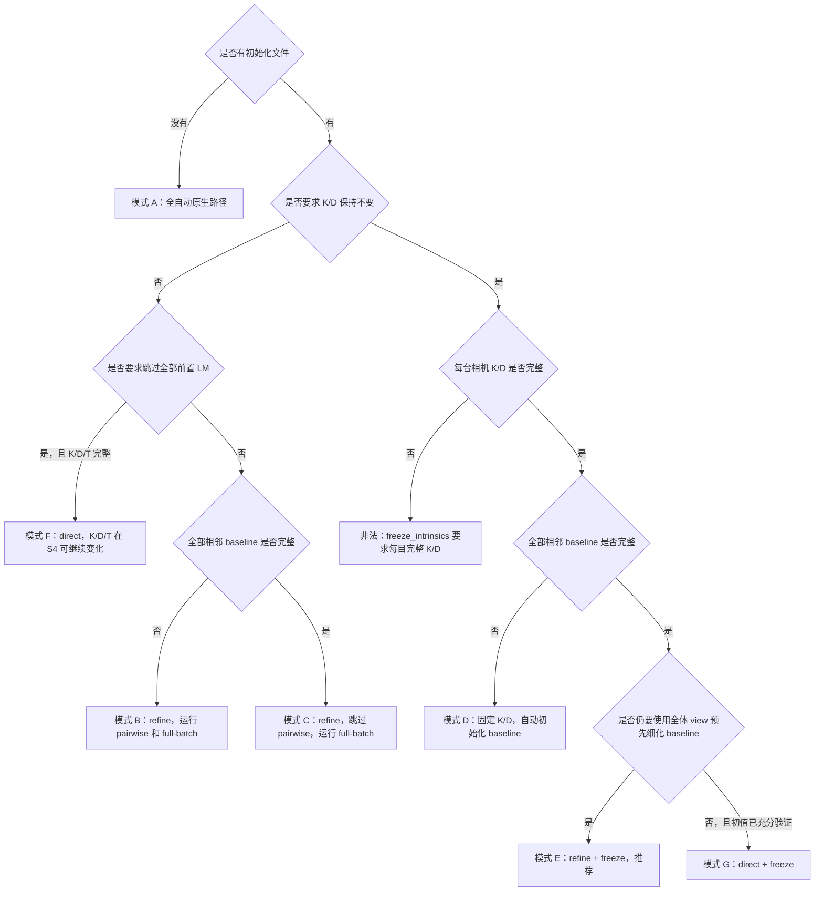

# 多目标定初始化模式与全量求解升级备忘

本文记录当前普通多相机标定的实际初始化、参数活动和求解路径，以及未来可能新增
final full-batch 求解模式时需要满足的条件。本文是设计与选型备忘，**当前不实施算法
升级，不改变默认行为，也不增加新的 task 配置字段**。

本文只讨论 `job: camera_calibration` 的双目／多目标定。Camera–IMU、滚动快门相机和
滚动快门 Camera–IMU 有各自的状态变量与求解器，不直接套用本文方案。

## 1. 当前固定存在的五个阶段

为便于描述，使用以下记号：

- $\mathbf I$：每台相机的投影内参；
- $\mathbf D$：每台相机的畸变参数；
- $\mathbf B$：相机列表中相邻相机的 baseline，方向为
  ${}^{cam_n}_{cam_{n-1}}\mathbf T$；
- $\mathbf P$：每个同步 target view 的标定板位姿。

当前普通多目标定可能经历以下阶段：

| 编号 | 阶段 | 作用 |
|---|---|---|
| S0 | 解析式相机初始化 | 从观测估计焦距等初值；显式提供该目内参时可跳过 |
| S1 | 单相机 LM | 每台相机分别优化 $\mathbf I,\mathbf D,\mathbf P$ |
| S2 | 相机对 baseline 初始化 | 通过共同观测、两目 PnP 中值和相机对 LM 得到 $\mathbf B$ 初值 |
| S3 | 初始化 full-batch refinement | 使用当时全部 view 联合调整相机链，令分阶段初值进入一致解域 |
| S4 | 最终原生增量估计 | 逐个尝试加入 view，每次重新优化当前全部已接纳 view，并执行接纳、回滚和异常点流程 |

当前正式结果始终来自 S4。S3 只是初始化 refinement，当前没有配置可以让 S3 直接成为
最终求解器。

无论采用哪种初始化策略，程序仍会读取图像、检测标定板、建立多相机共同观测图并检查
相机图是否连通。这里所说的“跳过”只表示跳过相应的优化阶段。

## 2. 三个互相独立的选择维度

### 2.1 是否提供初始化文件

不配置 `initialization` 时，K、D、baseline 全部由数据自动初始化。

配置初始化文件后，可以为任意相机提供 K/D，也可以提供相邻 baseline。公开初始化文件
使用 `T_cn_cnm1`；对 cam1 而言，它表示
${}^{cam1}_{cam0}\mathbf T$。

### 2.2 `refine` 与 `direct`

`initialization.strategy` 控制哪些**前置初始化优化**可以跳过：

- `refine`：把配置值作为初值，同时尽量保留原生 refinement；允许部分 seed；
- `direct`：要求每台相机 K/D 和全部相邻 baseline 完整，跳过 S0～S3，直接进入 S4。

`direct` 不等于固定参数。若没有同时配置 `freeze_intrinsics: true`，S4 中 K/D 仍会被
重新优化；baseline 在 S4 中也始终可以离开 seed。

### 2.3 `freeze_intrinsics`

`calibration.freeze_intrinsics` 控制的是参数活动状态，而不是初始化路径：

- `false`：K/D 在相应 LM 中 active；
- `true`：K/D 从读取 seed 后一直 fixed，只允许 baseline 和每帧板位姿更新。

启用它必须满足：

1. 至少两台相机；
2. 配置初始化文件；
3. 每台相机都完整提供与所选模型维数一致的 `intrinsics` 和
   `distortion_coeffs`；
4. 无畸变模型也必须显式写 `distortion_coeffs: []`。

该开关同时固定内参和畸变，当前不支持“只固定焦距、继续优化畸变”等拆分模式。

## 3. 当前可选模式完整列表

下表中的“解析”指 S0，“单目”指 S1，“pairwise”指 S2，“batch”指 S3，“最终”指 S4。

| 模式 | 有效配置与 seed 要求 | 解析 S0 | 单目 S1 | pairwise S2 | batch S3 | 最终 S4 的 active 物理参数 |
|---|---|---:|---:|---:|---:|---|
| A 全自动原生路径 | 无初始化；`freeze_intrinsics: false` | 执行 | 执行 | 执行 | 执行 | $\mathbf I,\mathbf D,\mathbf B$ |
| B `refine`，K/D 部分或完整，baseline 不完整 | 允许部分 K/D；相邻 baseline 缺少至少一条 | 未提供 I 的相机执行 | 所有相机执行 | 执行 | 执行 | $\mathbf I,\mathbf D,\mathbf B$ |
| C `refine`，baseline 完整，K/D 可部分提供 | 全部 $N-1$ 条相邻 baseline 完整 | 未提供 I 的相机执行 | 所有相机执行 | **跳过** | 执行 | $\mathbf I,\mathbf D,\mathbf B$ |
| D 固定 K/D，baseline 不完整 | `refine`；每目完整 K/D；`freeze_intrinsics: true` | **跳过** | **跳过** | 执行，只优化 $\mathbf B,\mathbf P$ | 执行，只优化 $\mathbf B,\mathbf P$ | $\mathbf B$ |
| E 固定 K/D，baseline 完整 | `refine`；每目完整 K/D；完整 baseline；`freeze_intrinsics: true` | **跳过** | **跳过** | **跳过** | 执行，只优化 $\mathbf B,\mathbf P$ | $\mathbf B$ |
| F `direct`，K/D 可更新 | `direct`；每目完整 K/D；完整 baseline；`freeze_intrinsics: false` | **跳过** | **跳过** | **跳过** | **跳过** | $\mathbf I,\mathbf D,\mathbf B$ |
| G `direct`，固定 K/D | `direct`；每目完整 K/D；完整 baseline；`freeze_intrinsics: true` | **跳过** | **跳过** | **跳过** | **跳过** | $\mathbf B$ |

所有模式的 S4 还包含每个已接纳 view 的 $\mathbf P$。表中只列最终需要交付的相机物理
参数。

### 3.1 多目下“部分 baseline”的实际行为

双目只有一条 baseline，因此只能是“没有”或“完整”。三目及以上可以只提供部分
`T_cn_cnm1`。

当前 `refine` 遇到部分 baseline 时，会先运行原生相机图的 pairwise 初始化，得到完整
相机链；然后用初始化文件中显式提供的相邻变换覆盖对应链值，再进入 S3。它不是只对缺失
的那一条边单独运行 LM。全部 $N-1$ 条相邻 baseline 都已提供时，才整体跳过 S2。

### 3.2 各模式适用场景

| 场景 | 推荐模式 | 原因 |
|---|---|---|
| 没有任何可信先验 | A | 保留完整原生自动初始化和求解路径 |
| 有厂商或历史 K/D/T，但希望全部参数继续修正 | B 或 C | `refine` 把 seed 当起点，不施加固定约束 |
| K/D 可靠，baseline 未知 | D | 固定 K/D，由共同观测建立并优化 baseline |
| K/D 可靠，baseline 相对可靠但仍需细化 | **E** | 跳过重复的单目和 pairwise 初始化，使用全体 view 先细化 baseline |
| K/D/T 都很接近最终值，希望缩短前置路径 | F | 直接进入原生增量阶段，但 K/D/T 仍能变化 |
| K/D 固定且 baseline 很接近最终值，希望直接进入增量阶段 | G | 跳过全部前置 LM，只在 S4 优化 baseline |

模式 F/G 对初值质量最敏感。对于“相对可靠”而不是经过独立验证的 baseline，优先使用
模式 E，不建议仅为了省去 S3 而选择 `direct`。

### 3.3 选择流程



### 3.4 不属于阶段选择的正交参数

以下参数会改变 S4 内部的数据选择或目标函数，但不会决定是否执行 S0～S3：

| 参数 | 作用 | 是否跳过初始化阶段 |
|---|---|---:|
| `shuffle` | 决定 target view 送入增量估计器的顺序 | 否 |
| `information_gain_tolerance` | 决定候选 view 的信息增益接纳阈值 | 否 |
| `remove_outliers` | 开关显式异常角点删除 | 否 |
| `min_views_for_outlier_statistics` | 决定何时开始建立异常角点统计 | 否 |
| `final_filtering` | 决定处理完全部 view 后是否再次过滤 | 否 |
| `blake_zisserman` | 给二维重投影 error term 设置鲁棒权重 | 否 |

这些参数与 A～G 模式可以组合。例如模式 E 可以同时选择
`shuffle: false`、`remove_outliers: true` 和 `blake_zisserman: true`；这仍然是模式 E，
只是最终增量阶段的加入顺序、角点删除和残差权重不同。

## 4. 固定可靠 K/D、细化相对可靠 baseline 的配置

这是目前推荐的模式 E。

任务文件：

```yaml
schema_version: "1.0.0"
kind: calibration_task
job: camera_calibration

dataset:
  type: directory
  path: /path/to/stereo_dataset

target:
  path: aprilgrid.yaml

cameras:
  - id: cam0
    model: pinhole-equi
  - id: cam1
    model: pinhole-equi

initialization:
  path: camera_calibration_initialization.yaml
  strategy: refine

calibration:
  freeze_intrinsics: true
  window_half_size_px: 7
  max_displacement_px: 1.0
  synchronization_tolerance_s: 0.0001
  shuffle: false
  remove_outliers: true
  final_filtering: true
  blake_zisserman: false
```

`pinhole-equi` 双目初始化文件：

```yaml
schema_version: "1.0.0"
kind: camera_calibration_initialization

cameras:
  cam0:
    intrinsics: [fu0, fv0, cu0, cv0]
    distortion_coeffs: [k10, k20, k30, k40]

  cam1:
    intrinsics: [fu1, fv1, cu1, cv1]
    distortion_coeffs: [k11, k21, k31, k41]
    T_cn_cnm1:
      - [r00, r01, r02, tx]
      - [r10, r11, r12, ty]
      - [r20, r21, r22, tz]
      - [0.0, 0.0, 0.0, 1.0]
```

该组合的准确含义为：

```text
读取并固定 cam0/cam1 的 K、D
  → 使用给定 T_cam1_cam0，跳过相机对初始化
  → 使用全部 view 的初始化 full-batch 优化 baseline 与板位姿
  → 进入最终增量估计，继续优化 baseline 与已接纳 view 的板位姿
```

如果改成 `strategy: direct`，S3 也会被跳过；如果删掉
`freeze_intrinsics: true`，K/D 会在后续阶段重新成为 active。

运行前先做输入检查：

```bash
install/release/bin/kalibr-noros validate \
  --config stereo_camera_calibration_task.yaml
```

## 5. 当前增量阶段实际承担的职责

S4 的“逐个加入”不是只优化新 view。每次加入候选 view 时，会重新优化“此前已接纳的
全部 view + 当前候选 view”，然后检查：

1. 是否在最大迭代次数内结束；
2. 最终代价是否低于开始代价；
3. 物理参数的秩是否增加，或信息增益是否超过阈值。

候选 view 不满足条件时，估计器恢复加入前的全部 design variable，并从问题中移除该
batch。显式异常角点处理也围绕已经接纳的 batch 工作。因此当前最终 YAML、RMS、观测
归档和可观性都对应 S4 最终保留的数据集合，而不是 S3 使用的全部输入 view。

需要区分两类“排除”：

- 信息增益不足会排除重复或低增益 view，不代表该图像存在错误；
- outlier filtering 删除大残差角点，必要时重建 batch，不等同于按整帧 RMS 删除图像。

## 6. “更新共享的相机对象”的准确含义

每个 `CameraGeometry` 同时持有：

```python
self.geometry  # 当前相机几何模型，包含 K、D
self.dv        # 优化器使用的 projection/distortion/shutter design variable
```

S3 接收 `cameraList` 中同一批 Python 对象，并把 `cam.dv` 加入优化问题。优化器原地更新
design variable 后，后续阶段继续使用的 `cameraList` 已经能够看到更新后的 K/D，因此
`solveFullBatch()` 不需要另外返回 K/D。

这里的“共享”是多个函数持有同一对象引用，不是多线程共享内存。

baseline design variable 和每帧板位姿则在 S3 内部创建：baseline 必须转换成
`sm.Transformation` 后显式返回；板位姿、优化问题、信息矩阵和 view 选择状态没有返回，
函数结束后不能作为正式最终证据使用。

相关实现位置：

- [`CameraCalibrator.py`](../src/kalibr/calibration/kalibr/python/kalibr_camera_calibration/CameraCalibrator.py)：相机对象、最终 batch 构造和增量估计器；
- [`CameraIntializers.py`](../src/kalibr/calibration/kalibr/python/kalibr_camera_calibration/CameraIntializers.py)：单目、pairwise 和初始化 full-batch；
- [`MulticamGraph.py`](../src/kalibr/calibration/kalibr/python/kalibr_camera_calibration/MulticamGraph.py)：相机连接图、baseline seed 覆盖及完整 seed 跳过逻辑；
- [`kalibr_calibrate_cameras`](../src/kalibr/calibration/kalibr/python/kalibr_calibrate_cameras)：五个阶段的顶层调用顺序；
- [`IncrementalEstimator.cpp`](../src/kalibr/calibration/incremental_calibration/src/core/IncrementalEstimator.cpp)：信息增益、秩、接纳和回滚。

## 7. 未来可选的 final full-batch 升级方案

以下内容只是后续决策依据，当前软件没有这些配置和行为。

如果未来需要用一次性全量优化取代 S4，不能直接把当前 `solveFullBatch()` 改名为最终
结果。应新增独立 final full-batch solver，使当前原生增量模式继续可选，并在同一套数据
上完成对照验证。

建议未来才考虑增加类似配置：

```yaml
calibration:
  solver_mode: incremental  # 设想字段；当前尚不存在
```

或：

```yaml
calibration:
  solver_mode: full_batch   # 设想字段；当前尚不存在
```

不要把上述字段加入当前生产 task；当前校验器不会接受它。

### 7.1 建议的全量最终流程

```text
单目初始化
  → baseline seed；缺失时使用 pairwise fallback
  → 构建包含全部 view 的正式 full-batch 问题
  → 可选 Blake–Zisserman 稳健优化
  → 按未加权像素残差删除异常角点
  → 按预先定义的 RMS/P95/Max 规则筛选异常 observation 或同步 view
  → 重建问题并再次全量优化
  → 最终可观性、指标、使用清单和报告
```

新的最终求解器必须长期持有并输出：

- 相机 K/D design variable；
- 相邻 baseline design variable；
- 每个 view 的板位姿；
- 原始观测、有效角点和 error term 映射；
- 输入、保留、拒绝 view 及原因；
- 每轮优化前后代价和失败状态；
- 最终 Hessian／reduced Fisher information 所需的问题结构。

### 7.2 Blake–Zisserman 可以迁移

Blake–Zisserman 挂在每个二维重投影 error term 上，不依赖
`IncrementalEstimator`，因此可以原样迁移到全量问题。对平方 Mahalanobis 距离
$r^2$，权重为：

$$
w(r^2)=\frac{\exp(-r^2)}{\exp(-r^2)+\epsilon}.
$$

大残差角点会被连续降权。它不能自动删除整张高 RMS 图像，也不能替代 view 覆盖和
可观性检查。最终交付的 RMS 应使用最终保留观测的**未加权原始像素残差**，不能把鲁棒
目标函数值直接写成像素 RMS。

当前调用使用二维误差，即 `BlakeZissermanMEstimator(2.0)`。当前 C++ 源码默认参数为
`pCut=0.999`、`wCut=0.1`。现有任务参数文档中的 `wCut=1e-6` 与源码不一致；若以后实施
新求解器，应先统一文档与实现，并建议显式传递三个参数，避免依赖隐式默认值。

### 7.3 异常点与高 RMS 图像处理

建议至少分两层处理：

1. 角点级：第一次稳健求解后，用未加权 $e_x,e_y$ 或残差范数识别异常角点，删除后
   重建问题；
2. 图像／view 级：计算每目角点数、RMS、P95、Max，以及同步多目 view 的合并指标，
   再按明确规则排除相机 observation 或整个同步 view。

双目生产任务更适合默认按整个同步 view 排除，避免左右目使用不对称的板位姿约束；如果
只删除单目 observation，必须保留原因并重新检查相机连接图。

不能简单删除 RMS 最大的固定比例图像。边缘、大倾角和近距离 view 可能残差略高，但对
畸变和外参很有价值。每次过滤后都要重新检查：

- 每台相机剩余帧数和共同 view 数；
- 图像区域、距离、俯仰、偏航和滚转覆盖；
- 多相机连接图；
- 最终秩、奇异值、条件数和弱模态。

### 7.4 增量语义如何处理

| 当前增量能力 | 全量模式处理方式 |
|---|---|
| Blake–Zisserman | 可给每个 error term 设置相同 policy |
| 显式角点过滤 | 可在 batch 求解后统计、重建并重新优化 |
| 最终秩和奇异值 | 在最终解重新线性化并消去每帧板位姿后计算 |
| 每次加入的路径相关信息增益 | 不能原样保留；可另定义最终线性化下的 leave-one-view-out 贡献，但含义不同 |
| 候选 view 接纳/拒绝 | 改为确定性的质量、覆盖和可观性筛选 |
| 每次加入失败回滚 | 改为每轮全量求解前保存全部状态，失败时整轮恢复 |
| shuffle 的路径影响 | 全量模式不依赖加入顺序，证据仍按稳定时间顺序保存 |

当前 S3 还缺少完整失败回滚；优化器直接原地更新共享相机对象。未来把 batch 作为正式
求解器时，必须在每轮开始前保存 K/D、baseline、板位姿和观测 mask，发生线性失败、
达到迭代上限或代价未下降时恢复全部状态。

## 8. 决定是否升级前的验证要求

未来只有满足以下条件，才适合考虑把 full-batch 提升为正式可选模式：

1. 在相同检测角点、相同初值和相同参数活动状态下，对比当前增量与新 full-batch；
2. 至少覆盖自动初始化、模式 E 和模式 G；
3. 比较 K/D、baseline 平移和旋转差异；
4. 比较训练集每目 RMS、双目综合 RMS、Alignment RMS/P95/Max；
5. 使用独立测试集运行 `kalibr-noros verify cameras`，不能只比较训练残差；
6. 对比最终使用 view、删除角点、图像覆盖和可观性弱模态；
7. 验证输入顺序变化不会显著改变 full-batch 结果；
8. 验证优化失败能完整回滚，不能留下部分更新的 K/D/T；
9. 保持现有 `incremental` 行为和结果兼容，不静默改变 v1.0.0 默认数学问题。

在完成上述实现和真实数据对照前，当前建议继续使用原生增量最终阶段。对于“可靠单目
K/D，不再优化；baseline 相对可靠，仍需细化”的实际任务，直接使用第 4 节的模式 E，
不需要等待求解器升级。

机器级入口只负责发现数据、生成 task、按顺序调用现有求解器和复用已完成交付，不实施
本文设想的 final full-batch 升级。产线入口与续跑边界见
[机器级一键标定工作流](MACHINE_CALIBRATION_WORKFLOW_ZH.md)。
