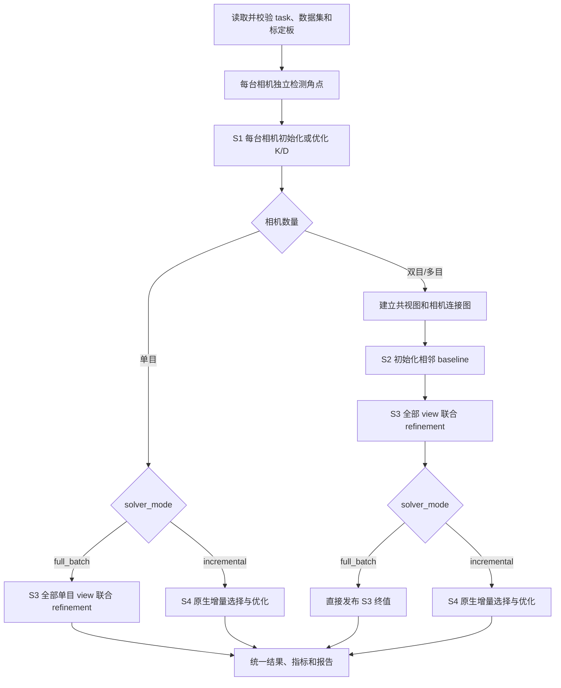

# 普通单目与多目标定求解模式

本文说明 `job: camera_calibration` 在单目、双目和多目下的实际执行流程，以及
`initialization`、`freeze_intrinsics` 和 `solver_mode` 的组合关系。这里的“多目”包含
双目。滚动快门、Camera–IMU 和 RS Camera–IMU 使用各自的联合求解器，不适用本文的
`solver_mode` 流程。

## 1. 三个配置入口

普通相机流程主要由三个相互独立的配置决定：

| 配置 | 默认值 | 决定什么 | 不决定什么 |
|---|---|---|---|
| `initialization.path` | 省略 | K/D 和相邻外参从哪里开始优化 | 不固定参数，也不增加先验 |
| `calibration.freeze_intrinsics` | `false` | K/D 在后续问题中是 active 还是 fixed | 不固定 baseline 或每帧标定板位姿 |
| `calibration.solver_mode` | `incremental` | 单目或多目最终采用 S3 全量结果还是 S4 增量结果 | 不改变角点检测和单目初始化方法 |

旧的 `initialization.strategy` 已删除。只要提供初值且没有启用
`freeze_intrinsics`，初值就会继续优化。

## 2. 总体流程



阶段名称用于区分结果来源：

| 阶段 | 单目 | 双目/多目 | 主要变量或结果 |
|---|---:|---:|---|
| S0 输入、检测、观测建库 | 执行 | 执行 | 图像、时间戳、角点及共同角点 ID |
| S1 单相机内参阶段 | 执行 | 每目独立执行 | 每目 K/D |
| S2 相机链 baseline 初始化 | 不适用 | 执行或由完整 seed 跳过 pairwise 部分 | $T_{c_n c_{n-1}}$ 初值 |
| S3 全部 view 联合 refinement | 仅 `full_batch` 执行 | 始终执行 | K/D、可用的相邻 baseline、每个 view 的板位姿 |
| S4 增量选择与优化 | 仅 `incremental` 执行 | 仅 `incremental` 执行 | 最终保留的 view、角点与相机参数 |

## 3. S0：检测、时间配对和 view

1. `time_range_s` 和 `frequency_hz` 先决定读取哪些帧。
2. 每台相机独立运行标定板检测和亚像素角点优化。检测失败的帧不会进入观测库。
3. 单目下，一个检测成功的时间戳形成一个 view；
   `synchronization_tolerance_s` 没有跨相机配对作用。
4. 多目下，观测按 `synchronization_tolerance_s` 近似配对。相机之间还必须存在共同的
   全局角点 ID，只有时间接近不足以建立相机图连接。
5. 一个多目 view 可以只包含部分相机；整个数据集必须把所有相机连接为一张连通图，
   否则不能确定完整相机链。

`window_half_size_px` 和 `max_displacement_px` 在本阶段生效。它们改变角点测量，因此会
影响所有后续阶段。

## 4. S1：每台相机的 K/D 初始化

每台相机独立选择以下一条路径：

| 该相机的 initialization | `freeze_intrinsics` | 实际行为 |
|---|---:|---|
| 无 K/D | `false` | 从观测解析初始化焦距，再运行原生单目 K/D LM |
| 只提供 `distortion_coeffs` | `false` | 先从观测初始化投影参数，覆盖 D seed，再运行同一单目 LM |
| 提供 `intrinsics`，D 可有可无 | `false` | 从观测取得分辨率，跳过解析焦距值，装载 seed，再运行同一单目 LM |
| 完整 K/D | `true` | 从观测取得分辨率并装载 seed，跳过单目 LM；K/D 后续保持 fixed |

`focal_initialization_min_visible_corner_ratio` 只影响需要从观测初始化焦距的路径。提供
`intrinsics` 后，它不再决定 seed 的焦距。

单目不允许 `freeze_intrinsics: true`。单目任务没有相机间外参；固定唯一相机的 K/D 后，
剩余 active 变量只有每帧标定板位姿，不能产生新的相机标定参数，最终只会原样发布
输入 seed，因此入口明确拒绝这种组合。

## 5. 单目在不同配置下的流程

单目支持 `incremental` 和 `full_batch`：

| 配置 | S1 | S2 | S3 | S4 | 最终结果 |
|---|---|---:|---:|---|---|
| 无 initialization | 观测初始化并优化 K/D | — | — | 执行 | S4 中最终接受 view 对应的 K/D |
| 部分 K/D seed | 以 seed 为起点补齐并优化 K/D | — | — | 执行 | S4 继续更新 K/D |
| 完整 K/D seed | 以完整 seed 为起点优化 K/D | — | — | 执行 | S4 继续更新 K/D |
| `freeze_intrinsics: true` | 配置校验失败 | — | — | — | 不产生结果 |
| 无或部分/完整 K/D seed，`full_batch` | 先按对应方式执行 S1 | — | 执行 | 跳过 | S3 全部 view 联合优化后的 K/D |

单目初始化文件只应包含 `cam0.intrinsics` 和/或 `cam0.distortion_coeffs`。`cam0` 不能
包含 `T_cn_cnm1`，因为不存在前一台相机。

单目 S4 的详细过程是：

1. 按时间顺序取得所有检测成功 view；默认 `shuffle: true` 会先随机打乱顺序。
2. 对当前 view 使用 PnP 生成标定板位姿初值。
3. 将该 view 构造成一个 batch，K/D 和该帧板位姿进入增量估计器。
4. 增量估计器执行有效性、秩和信息增益判断；接受时保留 view 并更新当前状态，拒绝时
   回滚该 batch。
5. 达到异常点统计门槛后，可按每个方向的重投影残差统计执行 $4\sigma$ 角点删除；
   删除角点后重建该 batch，再次加入失败时会移除整个 view。
6. `final_filtering: true` 时，处理完全部输入 view 后再检查所有已接受 batch。

当前原生门槛条件是已接受 batch 数严格大于
`min_views_for_outlier_statistics × 相机数量`；因此默认值 `20` 在单目下要求超过 20 个
已接受 batch，在双目下要求超过 40 个。这是现有增量实现语义，不是每台相机分别计数。

因此，单目最终使用帧数可能小于检测成功帧数，最终 K/D 来自 S4，而不是 S1 的临时
初始化结果。

单目 `full_batch` 则在 S1 后调用与多目相同的 `solveFullBatch()`：传入空 baseline
列表，为每个检测成功 view 建立一个 active 标定板位姿，并让 cam0 K/D 与全部二维
重投影残差进入同一个 LM。它不创建增量估计器，也不执行 view 接受、shuffle 或增量
异常点删除；S3 成功收敛后直接发布全部 view 的终值。

这里的空列表表示单目有 $N-1=0$ 条相机间外参，不表示存在一条“空”或待估计的
baseline。实际调用链为 `graph.refineAllViews(cameraList, [])`，内部继续调用
`solveFullBatch(cameraList, [], graph)`；相机列表仍包含 cam0，graph 仍包含全部单目
观测和时间戳。

S1 的 `calibrateIntrinsics()` 本身也会用全部单目观测联合优化 K/D 和逐帧板位姿，因此
单目 `full_batch` 当前是在 S1 终值上再运行一次近似同构的 LM。第二次求解不会增加跨
相机约束；它使用正式 full-batch 的收敛检查，并保留每帧板位姿、完整问题、残差和
求解返回值，供统一 RMS、报告、观测归档、协方差及可观性输出使用。若以后要消除这次
重复求解，需要先让 S1 返回同等完整的只读问题快照，而不能只复用它当前返回的成功布尔值。

单目 S4 与多目 `incremental` 复用同一个 `CameraCalibration`、
`IncrementalEstimator` 和 `addTargetView()` 实现，也使用相同的信息增益、回滚、
Blake–Zisserman 和异常角点处理代码；但两者不是同一个数学问题：

| 区别 | 单目 S4 | 多目 S4 |
|---|---|---|
| 进入 S4 的初值 | S1 单目 LM 的 K/D | S3 联合 refinement 后的每目 K/D 和 baseline |
| 相机物理变量 | cam0 K/D | 每目 K/D 与 N−1 个相邻 baseline |
| 每个 batch | 一台相机的观测和该帧板位姿 | 同步 rig view 中各相机观测、共享板位姿和相机链 |
| 跨相机约束 | 无 | 共同角点通过共享板位姿和 baseline 约束各相机 |

可以把它理解为“同一个增量框架构造不同规模的问题”：单目传入空 baseline 列表，
多目传入 S3 refinement 后的 baseline 初值；每次加入 view 时，框架根据实际相机数和
该 view 中的观测建立对应残差。

单目默认配置为：

```yaml
calibration:
  solver_mode: incremental
  freeze_intrinsics: false
  window_half_size_px: 2
  max_displacement_px: 1.224744871391589
  focal_initialization_min_visible_corner_ratio: 1.0
  synchronization_tolerance_s: 0.02
  information_gain_tolerance: 0.2
  min_views_for_outlier_statistics: 20
  shuffle: true
  remove_outliers: true
  final_filtering: true
  blake_zisserman: false
```

## 6. S2：多目 baseline 初始化

N 台相机需要 N−1 个相邻外参：

```text
cam1.T_cn_cnm1 = T_cam1_cam0
cam2.T_cn_cnm1 = T_cam2_cam1
...
```

每个变换均满足 $\mathbf p_{c_n} = \mathbf T_{c_n c_{n-1}}
\mathbf p_{c_{n-1}}$。当前初始化文件只接受相邻变换，不接受一条非相邻
`T_cam2_cam0` 代替两条相邻变换。

| baseline seed 状态 | pairwise stereo LM | 进入 S3 的初值 |
|---|---|---|
| 完全未提供 | 执行相机连接图的最优边 pairwise stereo LM，再转换为相邻相机链 | 自动求得的全部相邻 baseline |
| 只提供部分相邻 baseline | 仍执行完整的连接图初始化；随后覆盖明确提供的相邻 baseline | 自动结果与 seed 的组合 |
| 完整提供 N−1 个相邻 baseline | 跳过 pairwise stereo LM | 全部使用 seed |

完整 baseline seed 只能跳过 S2 的 pairwise 部分。所有相邻 baseline 在 S3 中仍为
active，并且在适用的 S4 中继续优化；当前没有 `freeze_extrinsics`。

## 7. S3：全量联合 refinement

单目只在 `full_batch` 下运行 S3；双目/多目无论最终选择 `incremental` 还是
`full_batch` 都运行 S3。S3 将观测库的全部 view 放进一个联合 LM：

- 每目 K/D：默认 active；`freeze_intrinsics: true` 时 fixed；
- 多目 N−1 个相邻 baseline：始终 active；单目没有该变量块；
- 每个 view 的标定板位姿：始终 active；
- 每个检测成功且有效的角点：建立二维重投影残差。

S3 直接更新前面创建的共享相机对象。多目 `incremental` 下，优化后的 K/D 会成为 S4
的起点，S3 返回的 baseline 数值也会成为 S4 新建 baseline 变量的起点。这里没有“先
算一份 S3，随后又从原始初值开始”的行为。单目 `full_batch` 和多目 `full_batch` 都把
S3 直接作为终值。

需要区分两个名称：

- **S3 full-batch refinement**：单目 `full_batch` 及所有双目/多目任务执行的联合优化；
- **`solver_mode: full_batch`**：S3 成功后直接将其作为最终结果，不再执行 S4。

## 8. `incremental` 与 `full_batch`

| 项目 | `incremental` | `full_batch` |
|---|---|---|
| S1 | 执行 | 执行 |
| S2 | 仅多目执行 | 仅多目执行 |
| S3 | 仅多目执行 | 单目和多目均执行 |
| S4 | 执行 | 跳过 |
| 最终结果来源 | S4 增量估计器 | S3 联合 LM |
| 最终 view | 通过增量接受与过滤后保留的 view | 观测库中的全部 view |
| 信息增益、回滚 | 生效 | 不生效 |
| `shuffle` | 生效 | 不生效 |
| 增量 $4\sigma$ 角点删除 | 可生效 | 不生效 |
| Blake–Zisserman | 可应用于 S4 batch | 不应用于 S3 |
| 可观性 | 最终增量问题；提供 seed 时强制分析 | 对 S3 终值只读重线性化 |

`full_batch` 中若显式填写 `shuffle`、`qr_tolerance`、
`information_gain_tolerance`、`min_views_for_outlier_statistics`、`remove_outliers`、
`final_filtering` 或 `blake_zisserman`，配置可以读取，但终端会明确提示这些增量专用字段
未应用。S3 线性求解失败、返回失败状态或达到最大迭代数时，`full_batch` 任务失败，不
发布貌似成功的结果。

单目和多目复用同一个 `solveFullBatch()` 与只读结果适配层；单目传入空 baseline
列表，多目传入 S2 的相邻 baseline 初值。

## 9. 多目配置组合

K/D 初值、baseline 初值和最终求解模式可以正交组合。先分别判断三个维度：

### 9.1 K/D 决策

| K/D seed | `freeze_intrinsics` | S1 | S3/S4 中 K/D |
|---|---:|---|---|
| 无或部分 | `false` | 从观测补齐并运行单目 LM | active |
| 每目完整 | `false` | 每目仍运行单目 LM | active |
| 每目完整 | `true` | 跳过单目 LM | fixed |
| 任一相机不完整 | `true` | 配置校验失败 | 不执行 |

### 9.2 baseline 决策

| 相邻 baseline seed | S2 pairwise | S3/S4 中 baseline |
|---|---|---|
| 无 | 执行 | active |
| 部分 | 执行完整连接图初始化，再覆盖 seed | active |
| 完整 | 跳过 | active |

### 9.3 最终结果决策

| `solver_mode` | S3 后续 | 适合的输入假设 |
|---|---|---|
| `incremental` | 运行 S4，允许拒绝 view 和删除异常角点 | 数据可能含质量差、重复或不提供有效信息的 view |
| `full_batch` | 直接输出 S3 | 已确认每个 view 和角点可信，希望全部参与同一个问题 |

常用完整组合如下：

| 配置 | S1 | S2 pairwise | S3 | S4 | 最终 K/D/baseline |
|---|---|---|---|---|---|
| 无 seed，`incremental` | 执行 | 执行 | 执行 | 执行 | 均 active，输出 S4 |
| K/D seed，baseline 不完整，`incremental` | 从 seed 优化 | 执行 | 执行 | 执行 | 均 active，输出 S4 |
| K/D seed，完整 baseline，`incremental` | 从 seed 优化 | 跳过 | 执行 | 执行 | 均 active，输出 S4 |
| 完整 K/D 且冻结，baseline 不完整，`incremental` | 跳过 | 执行 | 执行 | 执行 | K/D fixed，baseline active，输出 S4 |
| 完整 K/D 且冻结，完整 baseline，`incremental` | 跳过 | 跳过 | 执行 | 执行 | K/D fixed，baseline active，输出 S4 |
| 无 seed，`full_batch` | 执行 | 执行 | 执行并作为终值 | 跳过 | 均 active，输出 S3 |
| K/D seed，完整 baseline，`full_batch` | 从 seed 优化 | 跳过 | 执行并作为终值 | 跳过 | 均 active，输出 S3 |
| 完整 K/D 且冻结，完整 baseline，`full_batch` | 跳过 | 跳过 | 执行并作为终值 | 跳过 | K/D fixed，baseline active，输出 S3 |

## 10. 配置示例

### 10.1 多目保留原生增量选择

```yaml
calibration:
  solver_mode: incremental
  freeze_intrinsics: false
  shuffle: true
  information_gain_tolerance: 0.2
  remove_outliers: true
  final_filtering: true
  blake_zisserman: false
```

### 10.2 单目或多目使用全部 view

```yaml
calibration:
  solver_mode: full_batch
  freeze_intrinsics: false
  window_half_size_px: 2
  max_displacement_px: 1.224744871391589
  synchronization_tolerance_s: 0.02
```

单目忽略跨相机同步语义且没有 baseline 变量；多目仍按同步容差建立共视关系并优化相邻
baseline。

### 10.3 使用可靠 K/D，只优化多目外参与板位姿

```yaml
initialization:
  path: initialization_stereo.yaml

calibration:
  solver_mode: full_batch
  freeze_intrinsics: true
```

初始化文件必须为每目提供完整 K/D；baseline 可以省略、部分提供或完整提供。即使完整
提供 baseline，它仍会在 S3 中优化。

命令在单目和多目下相同，相机数量由 task 的 `cameras` 列表决定：

```bash
install/release/bin/kalibr-noros calibrate cameras \
  --config path/to/camera_calibration_task.yaml \
  --output-dir path/to/result
```

## 11. 输出和失败语义

所有有效组合复用同一套结果 YAML、指标、HTML/PDF、观测归档和可视化输出：

- 单目结果包含 cam0 K/D 和重投影 RMS，不包含相邻外参或 alignment；
- 多目结果按相机列表保存每目 K/D、每条相邻 `T_cn_cnm1`、每目 RMS 和相邻目
  alignment；
- `incremental` 的输入 view 数与最终使用 view 数可以不同，并可记录 selection history；
- `full_batch` 不产生增量 selection event，输入 view 数应等于最终使用 view 数；
- `full_batch` 在终值处只读重线性化，用于协方差和 reduced Fisher information
  可观性分析，不再次更新参数。

以下情况会在发布结果前失败：数据或配置不合法、某目无法初始化 K/D、多目相机图不
连通、固定内参缺少任一 K/D、单目请求固定内参，以及最终指定
求解器发生线性求解失败或未满足收敛条件。

## 12. 选择建议

- **普通单目且输入未经严格筛选**：使用 `incremental`，保留 view 接受和异常点处理。
- **普通单目且确认所有检测均可信**：可使用 `full_batch`，让全部 view 联合优化 K/D。
- **多目且输入未经严格筛选**：使用 `incremental`，保留 view 接受、回滚和异常角点处理。
- **多目且确认所有检测均可信**：可使用 `full_batch`，让全部 view 进入同一最终问题。
- **已有可靠 K/D 且只关心外参**：每目提供完整 K/D，设置
  `freeze_intrinsics: true`；baseline 仍会优化。
- **已有可靠 baseline**：提供完整相邻 baseline 可跳过 pairwise 初始化，但它不是固定
  外参约束，S3/S4 仍会调整它。
- **需要可重复的增量顺序**：设置 `shuffle: false`。当前没有 `shuffle_seed`。

完整字段默认值和合法范围见 [任务参数说明](TASK_PARAMETERS_ZH.md)，初始化文件格式见
[初始化说明](INITIALIZATION_ZH.md)。
